# Sistem mimarisi

Bu belge paas'ın nasıl çalıştığını ve neden böyle tasarlandığını anlatır. Her iddia koddan
(`cmd/paas`, `internal/*`, `internal/store/migrations`, `infra/`) doğrulanmıştır; özellik listesi
için [README](../README.md), faz geçmişi için [PHASES.md](PHASES.md), ölçümler için
[MEASUREMENTS.md](MEASUREMENTS.md), arıza senaryoları için [FAILURE-SCENARIOS.md](FAILURE-SCENARIOS.md).

**İçindekiler:**
[1. Genel bakış](#1-genel-bakış) ·
[2. Bileşenler](#2-bileşenler) ·
[3. Bir push'un yolculuğu](#3-bir-pushun-yolculuğu) ·
[4. Deploy modeli](#4-deploy-modeli) ·
[5. Veri modeli](#5-veri-modeli) ·
[6. Kubernetes yerleşimi](#6-kubernetes-yerleşimi) ·
[7. Güvenlik](#7-güvenlik) ·
[8. Dağıtım (AWS)](#8-dağıtım-aws) ·
[9. Ölçeklenebilirlik ve bilinen sınırlar](#9-ölçeklenebilirlik-ve-bilinen-sınırlar) ·
[10. Tasarım kararları](#10-tasarım-kararları)

---

## 1. Genel bakış

paas, bir GitHub reposuna yapılan her push'u **değişmez bir deploy'a** çeviren Git tabanlı bir
PaaS'tır. Kontrol düzlemi tek bir Go ikilisidir (`cmd/paas`): HTTP API'si, sunucu tarafında
render edilen web arayüzü, webhook alıcısı, worker havuzu ve bir dizi uzlaştırma döngüsü aynı
süreçte çalışır. **PostgreSQL tek doğruluk kaynağıdır**: kuyruk, deploy durumu, alias'lar, loglar
ve bildirim outbox'ı oradadır; Kubernetes nesneleri bu durumun bir yansımasıdır ve döngüler kümeyi
sürekli veritabanına uydurur. Her commit kendi `Deployment`/`Service`/`Ingress` üçlüsüyle çalışır;
production ve preview adresleri bu deploy'ları gösteren **alias**'lardır, bu yüzden rollback bir
Ingress arka ucunun değişmesinden ibarettir. Hedef ortam tek düğümlü bir k3s kümesidir (AWS EC2
t4g, arm64); imajlar rootless BuildKit ile derlenip ECR'a itilir, trafiği Traefik karşılar,
sertifikaları cert-manager üretir.

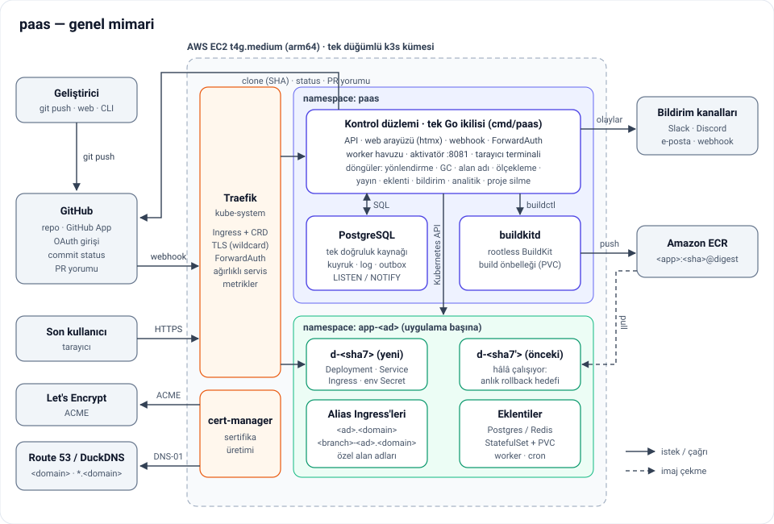

---

## 2. Bileşenler

### 2.1 Kontrol düzlemi (`cmd/paas`)

`main.go` tüm parçaları tek süreçte kurar; her döngü kendi goroutine'inde `ctx` iptal edilene
kadar çalışır, kapanışta HTTP sunucusu 15 sn içinde durur ve süren deploy'ların bitmesi beklenir.
Builder ve deployer iki kipte çalışır: `dryrun` (yerel geliştirme, testler) ve gerçek
(`buildkit`/`docker`, `kubernetes`). Kubernetes'e bağlı döngüler dry-run kipinde ya hiç başlamaz
ya da yalnızca veritabanını günceller.

| Bileşen | Paket | Sorumluluk |
|---|---|---|
| HTTP API | `internal/api` | `/api/*` REST uçları, SSE log akışı, deploy hook'ları (`/api/hooks/deploy/{token}`), rol denetimi (`requireApp`) |
| Web arayüzü | `internal/web` | `html/template` + htmx; oturum, CSRF, CSP; `/` altındaki her şey |
| Webhook | `internal/webhook`, `api/server.go` | `POST /webhooks/github`: imza, push / pull_request / installation olayları |
| Worker | `internal/worker` | Kuyruktan iş alma, build → deploy → ready, heartbeat, çökme kurtarma, iptal |
| Build | `internal/build`, `internal/process` | SHA ile fetch, proje algılama, Dockerfile üretimi, `buildctl`, süreç kümesi (`paas.yaml` / `Procfile`) |
| Deploy | `internal/deploy` | Namespace, kota, Secret, Deployment, Service, Ingress, hazır olma, uyutma, canary katmanı, eklentiler |
| Yönlendirme senkronu | `internal/routing` | Alias ve özel alan adı rotalarını veritabanından kümeye uygular; dakikada bir uzlaştırır |
| GC | `internal/cleanup` | Saklama politikası, emekliye ayırma (`retired`), küme nesnelerinin silinmesi |
| Alan adı denetimi | `internal/domains` | CNAME / TXT doğrulaması, yeniden denetim, bekleme süresi, sertifika durumu |
| Sıfıra ölçekleme | `internal/scale` | Traefik sayaçlarından boşta kalma tespiti; aktivatör (`:8081`) ile uyandırma |
| Yayın denetleyicisi | `internal/rollout` | Canary ağırlıkları ve izlemeli geçişte otomatik geri alma (30 sn'de bir) |
| Eklenti denetleyicisi | `internal/addons` | Yönetilen Postgres / Redis, preview kopyaları, yedek, geri yükleme (10 sn'de bir) |
| Analitik | `internal/analytics` | Traefik metriklerinden dakikalık istek sayıları ve gecikme (`request_metrics`, 7 gün) |
| Bildirimler | `internal/notify` | Olaylar → outbox → e-posta / Slack / Discord / webhook, yeniden denemeli |
| Proje silme | `internal/appdelete` | Üç adımlı, tekrar edilebilir silme (bkz. §5) |
| GitHub | `internal/github` | App kurulum token'ları, commit status, PR yorumu, yorum aynalama, kurulum senkronu |
| Kimlik ve yetki | `internal/auth`, `internal/plans`, `internal/ratelimit`, `internal/protect` | Oturum, token, rol; plan limitleri; hız sınırı; deploy koruması (ForwardAuth) |
| Tarayıcı terminali | `internal/terminal`, `internal/wsock` | WebSocket üzerinden pod'a `exec`; denetim kaydı |
| Log hub'ı | `store/notify.go` | Tek `LISTEN` bağlantısı; log satırı ve durum değişikliklerini SSE istemcilerine dağıtır |

Yanında üç yardımcı ikili vardır: `paas-cli` (komut satırı istemcisi), `paas-dockerfile`
(algılayıcının ürettiği Dockerfile'ı yerelde gösterir), `paas-envkey` (şifreleme anahtarı üretir).

### 2.2 Platform bileşenleri

| Bileşen | Yer | Görev |
|---|---|---|
| PostgreSQL 16 | `infra/k8s/10-postgres.yaml`, namespace `paas` | Durum, kuyruk, loglar, outbox; `LISTEN/NOTIFY` ile canlı log ve bildirim uyandırma |
| buildkitd (rootless) | `20-buildkitd.yaml` | İmaj derleme; kontrol düzlemi `buildctl` ile yerel bağlam gönderir |
| Registry (ECR) | `infra/terraform/ecr.tf`, `internal/registry` | `<prefix>/<app>:<sha>-<deploy id>` imajları; repo ilk push'ta şablondan oluşur; artık tutulmayan deploy'ların imajlarını kontrol düzlemi siler (Faz 30) |
| k3s | `cloud-init/bootstrap.sh` | Tek düğümlü Kubernetes; NetworkPolicy'leri gömülü kube-router uygular |
| Traefik | k3s ile gelir, `05-traefik-config.yaml` | Ingress ve CRD sağlayıcısı, TLS, ForwardAuth, ağırlıklı servis, Prometheus metrikleri |
| cert-manager | Helm, `40-tls.yaml`, `41-tls-wildcard.yaml` | Wildcard sertifika (DNS-01) ya da host başına sertifika (HTTP-01) |
| GitHub App | `internal/github/app.go` | Kısa ömürlü kurulum token'larıyla clone, status ve yorum; tek webhook adresi |

---

## 3. Bir push'un yolculuğu

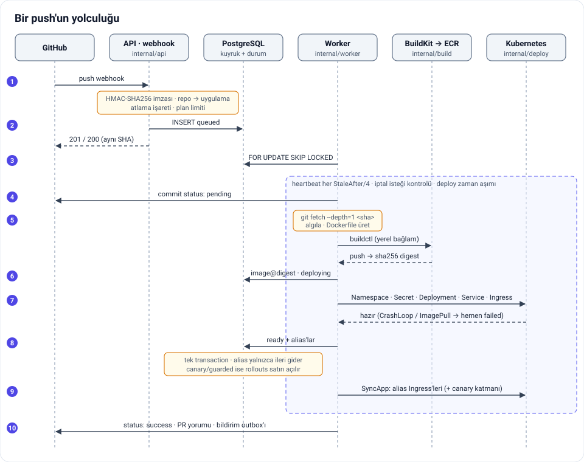

1. **Webhook.** GitHub `POST /webhooks/github` çağırır. Gövde 5 MiB ile sınırlıdır;
   `X-Hub-Signature-256` HMAC-SHA256 ile sabit zamanda doğrulanır. Repo bir uygulamaya bağlı
   değilse, commit mesajında `[skip deploy]` / `[skip ci]` varsa ya da push bir branch'e değilse
   (ör. etiket) yanıt `202`'dir; GitHub teslimatı kırmızı göstermesin diye. Branch silme ve kapanan
   PR, preview alias'ını hemen kaldırır.
2. **Kuyruk.** Plan limitleri (`plans.Guard.CheckDeploy`) geçilirse `EnqueueDeployment`
   `queued` bir satır yazar. `(app_id, commit_sha, generation)` benzersizdir: aynı SHA'nın tekrar
   teslimatı mevcut satırı döndürür (`200`), yeni iş üretmez. Emekliye ayrılmış ve nesneleri
   silinmiş bir commit yeniden kuyruğa girer.
3. **İş alma.** Her worker goroutine'i `ClaimNextFor` ile sıradaki işi alır:
   `FOR UPDATE SKIP LOCKED` aynı işin iki worker'a gitmesini engeller; işlem başındaki
   `pg_advisory_xact_lock` ekip başına eşzamanlı build sınırını yarışsız kılar. Askıya alınmış
   ekiplerin ve silinmekte olan uygulamaların işleri atlanır. Satır `building` olur, `attempts`
   artar.
4. **Heartbeat ve status.** Worker GitHub'a `pending` status'u gönderir ve `StaleAfter/4`'te bir
   heartbeat yazar. Heartbeat'i reddedilen (iş başka bir denemeye geçmiş) worker kendi bağlamını
   iptal eder; heartbeat'i 2 dk duran iş kurtarma döngüsünce en fazla 2 denemeye kadar yeniden
   kuyruğa alınır. Kullanıcının iptal isteği (`cancel_requested_at`) de heartbeat'te görülür.
5. **Build.** Önce, varsa, preview veritabanı kopyası istenir (build ile paralel yürür). Kontrol
   düzlemi commit'i **SHA ile** `git fetch --depth=1` çeker (token argv'ye değil git ortamına
   verilir), kök dizin ayarına göre projeyi algılar, gerekirse Dockerfile üretir ve `buildctl` ile
   yerel bağlamı rootless buildkitd'ye gönderir. İmaj `<registry>/<app>:<sha>-<deploy id>` olarak itilir ve
   **digest'le sabitlenir** (`…@sha256:…`). Süreç kümesi (`paas.yaml` / `Procfile`) ve build süresi
   kaydedilir. Redeploy ve promote'ta imaj hazırdır; build atlanır.
6. **Deploy.** Satır `deploying` olur. `internal/deploy` sırasıyla namespace'i (kota, LimitRange,
   NetworkPolicy), ortamın değişkenlerinden ve eklenti bağlantılarından oluşan değişmez
   `d-<sha7>-env` Secret'ını, `Deployment`, `Service` ve `<sha7>-<app>.<domain>` Ingress'ini,
   ardından worker ve cron süreçlerini oluşturur.
7. **Hazır olma.** Pod hazır olana kadar beklenir; `CrashLoopBackOff`, `ImagePullBackOff` ya da
   kota reddi görülürse zaman aşımı beklenmeden `failed` olunur ve çöken uygulamanın son log
   satırları hata mesajına eklenir.
8. **Alias geçişi.** `MarkReadyWithRollout` tek transaction'da satırı `ready` yapar ve alias'ları
   taşır. Alias **yalnızca ileri gider**: geç biten eski bir build daha yeni bir deploy'un
   alias'ını ezemez. Deploy sırasında branch silindiyse sonuç `retired`, iptal istendiyse
   `canceled` olur. Uygulama canary / guarded kipindeyse aynı transaction bir `rollouts` satırı
   açar (§4.4).
9. **Rotalar.** `routing.Syncer.SyncApp` alias'ları ve özel alan adlarını Ingress'lere uygular.
   Hata deploy'u düşürmez: deploy kendi adresinde zaten erişilebilirdir, dakikalık uzlaştırma
   döngüsü tekrar dener.
10. **Bildirim.** Bildirimci zinciri önce olayı outbox'a yazar (`notification_events` +
    `notification_deliveries`), sonra GitHub'a `success`/`failure` status'u ve dalın açık PR'larına
    uygulama başına tek, güncellenen bir yorum gönderir. Bildirimler en iyi çaba ilkesiyle
    çalışır: hata loglanır, deploy'un sonucunu değiştirmez. Son olarak GC tetiklenir.

Her log satırı `deployment_logs`'a yazılır; tetikleyici `pg_notify` üretir, log hub'ı ilgili SSE
istemcilerini uyandırır. `LISTEN` koparsa akış periyodik okumaya düşer.

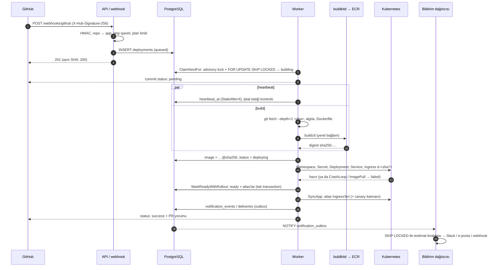

---

## 4. Deploy modeli

### 4.1 Değişmez deploy'lar, alias'lar ve adresler

Bir deploy hiç güncellenmez. Ortam değişkeni değişikliği, redeploy ya da promote aynı commit'in
**yeni bir neslini** (`generation`) üretir: kendi Secret'ı, kendi nesneleri ve kendi adresiyle.
Adlandırma `internal/naming`'dedir; tüm host'lar `<domain>` altında **tek etiketlidir**, böylece
tek bir `*.<domain>` sertifikası hepsini kapsar.

| Ne | Host | Kubernetes adı |
|---|---|---|
| Deploy (nesil 0) | `<sha7>-<app>.<domain>` | `app-<app>/d-<sha7>` |
| Deploy (nesil n) | `<sha7>-<n>-<app>.<domain>` | `app-<app>/d-<sha7>-<n>` |
| Production alias'ı | `<app>.<domain>` | Ingress `alias-<app>` |
| Preview alias'ı | `<branch>-<app>.<domain>` (etiket ≤ 63 karakter) | Ingress `alias-<branch>-<app>` |
| Özel alan adı | `www.ornek.com` | Ingress `domain-<host>-<hash>` + TLS Secret |
| Kontrol düzlemi | `<domain>` (apex) | `paas/paas` IngressRoute |
| Worker / cron | — | `d-<sha7>-w-<süreç>` / `d-<sha7>-c-<süreç>` |

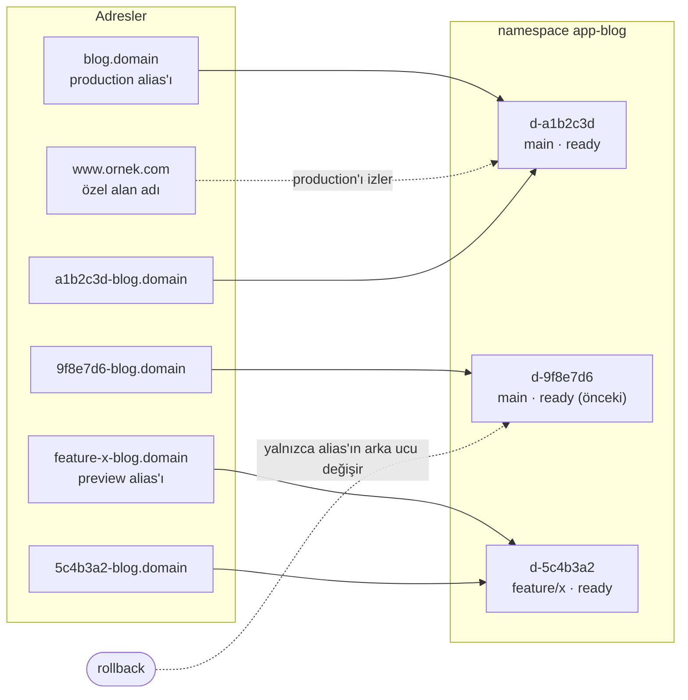

Alias'ların nereyi gösterdiği yalnızca `aliases` tablosunda kararlaştırılır. `routing.Syncer`
uygulama başına bir kilit altında tabloyu okuyup Ingress'leri uygular; aynı durum kümeye yazma
üretmez. Senkron üç yerden çağrılır: deploy hazır olunca (worker), rollback / promote sonrası
(API) ve dakikada bir (drift onarımı).

### 4.2 Ortamlar, rollback ve promote

Her deploy iki ortamdan birinde çalışır (`deployments.target`): production branch'inin
push'ları ve promote edilenler `production`, diğer her şey `preview`. Değişkenler ortama göre
çözülür (`all < production`, `all < preview < preview + branch`) ve deploy anında Secret'a
dondurulur; bir değişkeni değiştirmek çalışan deploy'u değiştirmez, redeploy gerekir.

- **Rollback** (`POST /api/apps/{name}/rollback`): yeni build ya da pod yok; production alias'ı
  hâlâ çalışan eski bir `ready` deploy'a döner. Hedef `FOR SHARE` ile kilitlenir, böylece eşzamanlı
  bir GC onu emekliye ayıramaz; özel alan adları production'ı izlediği için birlikte döner.
  Yönlendirme hata verirse karar kaybolmaz: veritabanına yazılmıştır, döngü uygular.
- **Promote:** bir preview deploy'unun imajı production değişkenleriyle yeni bir nesil olarak
  kuyruğa girer (`origin = promote`), build atlanır.
- **Redeploy / iptal / deploy hook:** aynı mekanizma; iptal kuyruktaki işi hemen, süren işi bir
  sonraki heartbeat'te durdurur.
- **Saklama** (`internal/cleanup`, 10 dk'da bir ve her deploy sonrası): bir alias'ın gösterdiği
  deploy asla emekliye ayrılmaz; production branch'inin en yeni 5 hazır deploy'u rollback hedefi
  olarak tutulur; alias'ı kalmamış preview'ler 72 saat sonra `retired` olur. Önce veritabanı,
  sonra küme: başarısız silme bekler ve tekrar denenir.

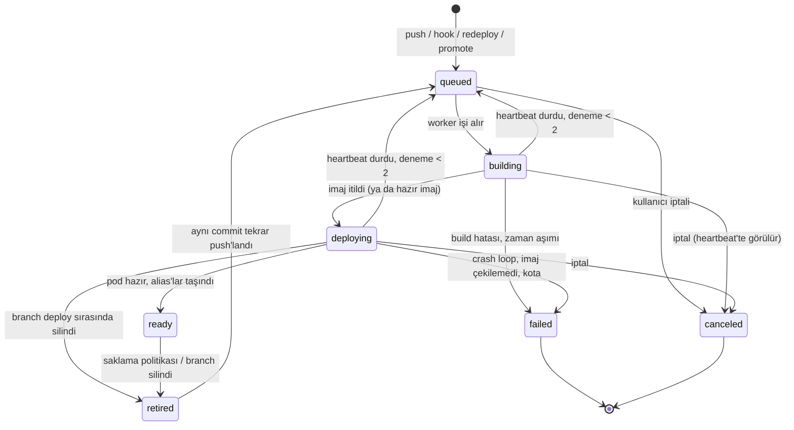

### 4.3 Süreç tipleri ve tek nesil kuralı

`web` dışında süreçler de aynı imaj ve aynı Secret'la çalışır: worker'lar `Deployment
d-<sha7>-w-<ad>`, cron'lar `CronJob d-<sha7>-c-<ad>` olur ve web Deployment'ına aittir. Değişmez
deploy'lar yan yana yaşadığı için hangi neslin worker / cron çalıştıracağına alias'lar karar verir
(`process.PlanFor`): production alias'ının deploy'u tüm süreçleri, preview alias'ının deploy'u
yalnızca `previews: true` olanları çalıştırır; geri kalan nesillerin worker'ları 0'a, cron'ları
askıya alınır. Yeni production'ın cron'ları askıda oluşur ve alias geçince açılır; böylece bir
zamanlama iki kez tetiklenmez. Rollback worker'ları da eski nesle taşır.

### 4.4 Canary ve izlemeli otomatik geri alma

Uygulama başına `rollout_settings.mode`: `instant` (varsayılan), `guarded`, `canary`. Durum
`rollouts` tablosundadır (uygulama başına en fazla bir `running`/`paused`, kısmi benzersiz
indeks).

- **canary:** production alias'ı önceki deploy'da kalır. Standart Ingress trafik bölemediği için
  yayın süresince production host'larına Traefik CRD'lerinden bir katman eklenir: ağırlıklı
  `TraefikService rollout` (`d-<eski>` %100−w, `d-<yeni>` %w) ve öncelik 100000'lik
  `IngressRoute`. Alias Ingress'i hiç silinmez; katman yayın bitince kaldırılır, host hiçbir an
  rotasız kalmaz. Varsayılan adımlar %10 → %50 → %100, adım başına 5 dk.
- **guarded:** alias hemen geçer, yeni production `guard_seconds` (varsayılan 10 dk) izlenir.
- **Karar** (`rollout.Decide`, 30 sn'de bir): yeni deploy'un 5xx oranı ve p95 gecikmesi Faz 19
  dakikalık metriklerinden, mevcut production'ınkiyle karşılaştırılır (mutlak tavan + artış
  payı, en az istek sayısı). Sonuç `advance`, `promote`, `rollback` (canary'de ağırlık 0, guarded'da
  alias önceki deploy'a) ya da metrik yoksa `abort`. Her geçiş compare-and-set'tir: elle yapılan
  rollback ya da daha yeni bir deploy önce gelirse eski karar düşer.

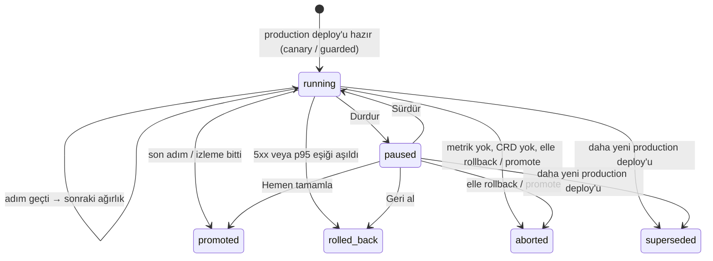

### 4.5 Sıfıra ölçekleme ve aktivatör

`internal/scale` her aralıkta Traefik'in servis başına istek sayaçlarını okur; sayacı
`PAAS_SCALE_TO_ZERO_AFTER` boyunca değişmeyen deploy uyutulur (örnek kurulumda 30 dk). Okuma
hatası hiçbir şeyi uyutmaz: hatalar yalnızca deploy'ları uyanık tutar. Production deploy'ları
yalnızca uygulama izin verirse uyur.

Uyutma Ingress'lere dokunmaz. Deployment 0 kopyaya iner, `Service d-<sha7>`'nin selector'ü
kaldırılır ve kontrol düzlemi pod'unun `:8081` adresini gösteren `EndpointSlice
d-<sha7>-activator` yazılır. İlk istek aktivatöre düşer; aktivatör Ingress host'undan deploy'u
bulur, 1 kopyaya çıkarır, hazır olana kadar isteği (gövde ≤ 10 MiB) bekletir, selector'ü geri
koyup slice'ı siler ve isteği doğrudan pod IP'sine iletir. Aynı deploy için gelen eşzamanlı
istekler tek bir uyandırmayı paylaşır; WebSocket `Upgrade` istekleri tünellenir. Bu sayede
yönlendirme, rollback ve GC uyku durumundan habersizdir; `deployments.sleeping_since` yalnızca
arayüz için bir aynadır.

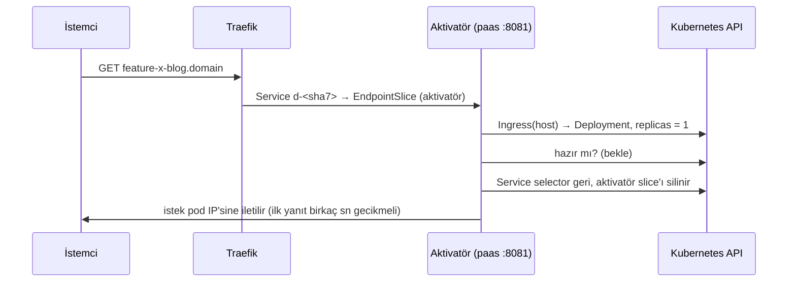

### 4.6 Yönetilen veritabanları ve preview kopyaları

Bir eklenti (`addons`) uygulamanın namespace'inde çalışan tek kopyalı bir Postgres ya da Redis
`StatefulSet`'idir. Denetleyici 10 sn'de bir vadesi gelen eklentileri `SKIP LOCKED` ile kiralar
ve kümeyi satıra uydurur. Uzun işler (kopya, silme, şifre rotasyonu, yedek, geri yükleme)
deterministik adlı Job'lardır: tekrar çalışan bir adım ikinci bir iş başlatmaz, ilkini bulur;
sonuç pod'un sonlandırma mesajından okunur.

Postgres'te her preview branch'i kendi rolü ve veritabanıyla (`preview_<slug>[_<hash>]`)
production'ın bir kopyasını alır; kopya build ile paralel yürür, deploy ondan önce onu bekler ve
`DATABASE_URL` kopyayı gösterir. İsteğe bağlı anonimleştirme kuralları kopyada uygulanır,
veritabanlarının `CONNECT` yetkisi `PUBLIC`'ten alınır (preview production'a bağlanamaz), boyut
eşiğini aşan veritabanı boş başlatılır.

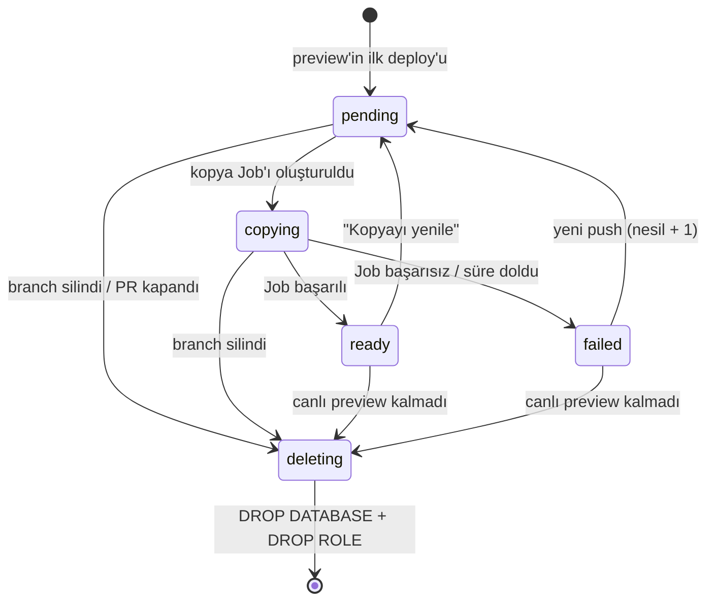

---

## 5. Veri modeli

Şema `internal/store/migrations` altındaki 21 dosyadır; kontrol düzlemi açılışta sırayla uygular
(`store.Migrate`). Kısıtlar mümkün olduğunca veritabanındadır: ad biçimleri `CHECK`, durumlar
`CHECK (… IN …)`, "uygulama başına bir etkin yayın" ve "eklenti başına bir geri yükleme" kısmi
benzersiz indeks.

```mermaid
erDiagram
    teams ||--o{ team_members : ""
    users ||--o{ team_members : ""
    users ||--o{ api_tokens : ""
    teams ||--o{ apps : "sahip"
    teams ||--o{ github_installations : "bağlar"
    github_installations ||--o{ github_installation_repos : ""
    apps ||--o{ deployments : ""
    deployments ||--o{ deployment_logs : ""
    deployments ||--o| deployment_processes : ""
    apps ||--o{ aliases : ""
    deployments ||--o{ aliases : "hedef"
    apps ||--o{ app_env : ""
    apps ||--o{ app_domains : ""
    apps ||--o| rollout_settings : ""
    apps ||--o{ rollouts : ""
    deployments ||--o{ rollouts : "önceki / yeni"
    apps ||--o{ addons : ""
    addons ||--o{ addon_branches : ""
    addons ||--o{ addon_backups : ""
    deployments ||--o{ preview_comments : ""
    teams ||--o{ notification_channels : ""
    notification_events ||--o{ notification_deliveries : ""
    notification_channels ||--o{ notification_deliveries : ""
    apps |o--o{ audit_log : "SET NULL"
    teams |o--o{ app_deletions : ""

    teams {
        bigint id PK
        text slug UK
        text plan "hobby | pro | unlimited"
        jsonb plan_limits "ekip başına istisnalar"
        timestamptz suspended_at
    }
    users {
        bigint id PK
        bigint github_id UK "kimlik; login değişebilir"
        text login UK "lower(login)"
        timestamptz suspended_at
    }
    team_members {
        bigint team_id PK
        bigint user_id PK
        text role "owner | member | viewer"
    }
    apps {
        bigint id PK
        text name UK "DNS etiketi"
        text repo_full_name UK
        text production_branch
        bigint team_id FK
        timestamptz deleting_at
    }
    deployments {
        bigint id PK
        bigint app_id FK
        text commit_sha "UK (app, sha, generation)"
        text status "queued … ready | failed | retired | canceled"
        text target "production | preview"
        text origin "git | redeploy | promote | hook"
        int generation
        text image "registry/app:sha-id@sha256"
        timestamptz image_released_at
        int attempts
        timestamptz heartbeat_at
        timestamptz sleeping_since
    }
    aliases {
        bigint id PK
        text hostname UK
        text kind "production | preview"
        bigint deployment_id FK
    }
    app_env {
        bigint app_id PK
        text key PK
        text target PK "all | production | preview"
        text git_branch PK
        text value "v1:key_id:AES-256-GCM"
    }
    app_domains {
        bigint id PK
        text hostname UK
        text status "pending | verified | active | error"
        bool routed
    }
    github_installations {
        bigint id PK "GitHub kurulum no"
        bigint team_id FK "bağlayan ekip"
    }
    addons {
        bigint id PK
        text kind "postgres | redis"
        text status
        text secrets "mühürlü"
        timestamptz reconciled_at "kiralama"
    }
    rollouts {
        bigint id PK
        text mode "canary | guarded"
        int weight
        text state
        jsonb verdicts
        timestamptz evaluated_at "kiralama"
    }
    preview_comments {
        bigint id PK
        bigint thread_id FK "NULL: başlık"
        text body
        text status "open | resolved"
    }
    notification_deliveries {
        bigint id PK
        text idempotency_key UK
        text status "pending | sending | sent | failed | skipped"
        timestamptz locked_until "kiralama"
    }
    audit_log {
        bigint id PK
        text action "terminal"
        text actor
        text app_name
    }
    app_deletions {
        bigint id PK
        bigint app_id UK "düz değer, FK değil"
        timestamptz rows_deleted_at
        timestamptz finished_at
        timestamptz claimed_until "kiralama"
    }
```

| # | Migration | Ne ekler |
|---|---|---|
| 001 | `init` | `apps`, `deployments` (commit başına bir), `aliases`, `deployment_logs`, kuyruk indeksi |
| 002 | `app_env` | Uygulama değişkenleri; deploy anında Secret'a dondurulur |
| 003 | `log_notify` | Log ve durum değişikliği için `pg_notify` tetikleyicileri |
| 004 | `lifecycle` | `retired`, `heartbeat_at`, `attempts`, `cleaned_at`: emekliye ayırma ve çökme kurtarma |
| 005 | `env_encryption` | `app_env.key_id`: AES-256-GCM, anahtar rotasyonu |
| 006 | `app_domains` | Özel alan adları, doğrulama ve bekleme süresi |
| 007 | `users_teams` | `users`, `teams`, `team_members`, `api_tokens`; uygulamalar `default` ekibine taşınır |
| 008 | `scale_to_zero` | `sleeping_since`, production için açık izin |
| 009 | `github_app` | `github_installations`, `github_installation_repos` |
| 010 | `build_settings` | `app_build_settings`, algılanan framework |
| 011 | `environments` | Ortam kapsamlı değişkenler, `target`/`origin`/`generation`, `canceled`, `deploy_hooks` |
| 012 | `metrics` | `request_metrics` (deploy × dakika) |
| 013 | `processes` | `deployment_processes`, `app_process_scale` |
| 014 | `rollouts` | `rollout_settings`, `rollouts` |
| 015 | `addons` | `addons`, `addon_branches`, `addon_backups` |
| 016 | `plans` | Ekip planları ve istisnalar, askıya alma, build süresi |
| 017 | `protection` | `app_protection`, paylaşım bağlantıları, tek kullanımlık nonce'lar |
| 018 | `comments` | `preview_comments` (başlık + yanıtlar tek tabloda) |
| 019 | `notifications` | Kanallar, olaylar, outbox (`notification_deliveries`), tercihler, outbox tetikleyicisi |
| 020 | `audit` | `audit_log` (terminal oturumları; tuş vuruşu ve çıktı saklanmaz) |
| 021 | `app_deletion` | `apps.deleting_at`, `app_deletions`; denetim kaydı uygulamadan uzun yaşar |
| 022 | `image_retention` | `deployments.image_released_at`: imajı registry'den silinen deploy'lar (redeploy bu imajı yeniden kullanmaz) |

**Proje silme** üç tekrar edilebilir adımdır (`internal/appdelete`): (1) tek transaction'da
`app_deletions` satırı ve `deleting_at`; kuyruktakiler iptal, sürenlere iptal isteği; (2) hiçbir
deploy çalışmadığında uygulama satırı silinir ve her şey `CASCADE` ile gider; satırlar kümeden
önce silinir ki hiçbir döngü nesneleri yeniden yaratmasın; (3) namespace ve tutulan PV'ler
silinir, ardından projenin registry'deki bütün imajları silinir (Faz 30), sonra `finished_at`
yazılır. Aynı ad ancak bundan sonra tekrar
alınabilir; yeni proje eski namespace'le karşılaşmaz.

---

## 6. Kubernetes yerleşimi

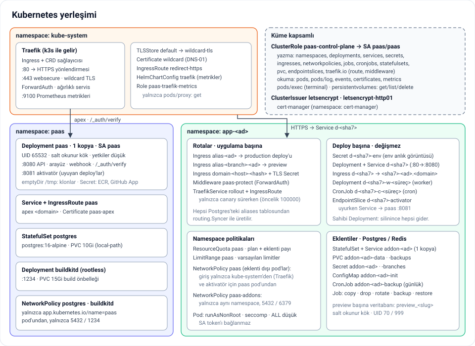

**Uygulama başına bir namespace** (`app-<ad>`), kontrol düzleminin ilk deploy'da oluşturduğu
dört politika taşır:

- `ResourceQuota paas`: ekip planına göre CPU isteği, bellek ve pod sayısı; eklentilerin payı
  ayrıca eklenir, bir veritabanı deploy'ların payını yemez. Askıya alınmış ekipte yeni pod'a
  kapanır.
- `LimitRange paas`: kendi limitini koymayan her konteyner için varsayılan.
- `NetworkPolicy paas`: eklenti dışı pod'lara giriş yalnızca `kube-system`'den (Traefik) ve
  sıfıra ölçekleme açıksa kontrol düzlemi pod'undan (aktivatör → pod). Uygulamalar birbirine
  yalnızca genel adresleri üzerinden erişebilir.
- `NetworkPolicy paas-addons`: eklenti sunucularına yalnızca aynı namespace'ten, yalnızca 5432 /
  6379. Traefik ve kontrol düzlemi dahil dışarıdan erişim yoktur.

Pod'lar `runAsNonRoot`, seccomp `RuntimeDefault`, `allowPrivilegeEscalation: false`, tüm Linux
yetkileri düşürülmüş ve servis hesabı token'ı bağlanmamış çalışır; hazır olma denetimi TCP'dir
(`/` rotası olmayan uygulama da hazır sayılır). Deploy başına nesnelerin sahibi `Deployment
d-<sha7>`'dir; emekliye ayırma tek bir silmeyle hepsini götürür.

**Traefik CRD'leri** yalnızca standart Ingress'in yapamadığı yerde kullanılır: canary'nin
ağırlıklı `TraefikService`'i ve öncelikli `IngressRoute`'u, deploy korumasının `Middleware
paas-protect`'i (ForwardAuth) ve kontrol düzleminin apex `IngressRoute`'u. Deploy ve alias rotaları
standart `networking.k8s.io/v1 Ingress`'tir.

**cert-manager** iki kurulum destekler: Route 53 ile `letsencrypt` ClusterIssuer'ı DNS-01'le
`<domain>` + `*.<domain>` wildcard sertifikasını üretir ve Traefik'in varsayılan `TLSStore`'u olur;
DuckDNS'te wildcard mümkün olmadığından `PAAS_INGRESS_CERT_ISSUER` ile her host kendi HTTP-01
sertifikasını alır. Özel alan adları her iki kurulumda da `letsencrypt-http01` ile host başına
sertifika alır. Tüm HTTP istekleri, ACME doğrulama yolu dışında, en düşük öncelikli bir
`IngressRoute` ile HTTPS'e yönlendirilir.

**Kontrol düzlemi namespace'i** (`paas`): tek kopyalı `Deployment paas` (UID 65532, salt okunur
kök, `/tmp` emptyDir'de klonlar), `StatefulSet postgres` (10 GiB `local-path`), rootless
`buildkitd` (15 GiB önbellek). `NetworkPolicy`'ler Postgres'e ve buildkitd'ye yalnızca
`app.kubernetes.io/name=paas` pod'unun erişmesine izin verir.

**RBAC (Faz 29, en az yetki).** Kontrol düzleminin ServiceAccount'u (`paas/paas`) küme genelinde
hiçbir namespace'li nesneye yazamaz. Yetkisi üç parçadır (`30-control-plane-rbac.yaml`):

- `ClusterRole paas-control-plane` (küme genelinde bağlı) yalnızca küme kapsamlı olanı taşır:
  `namespaces`, Retain politikalı birimler için `persistentvolumes` get/list/delete (Faz 28),
  `rolebindings` create ve `clusterroles` üzerinde yalnızca `paas-app-manager` adına `bind`.
- `ClusterRole paas-app-manager` uygulama namespace'i içindeki her fiili taşır ama küme genelinde
  **bağlanmaz**: kontrol düzlemi `app-<ad>`'ı oluşturduğu anda oraya `RoleBinding
  paas-control-plane` koyar (`internal/deploy/access.go`, `EnsureAppAccess`) ve yetkilendiricinin
  bağlamayı görmesini bekler; kota, LimitRange ve NetworkPolicy ondan sonra gelir. Açılışta
  `app-*` + `managed-by=paas` etiketli her namespace için aynı işlem idempotent olarak yapılır;
  Faz 29'dan önce açılmış namespace'ler böylece kendiliğinden bağlanır. Kontrol düzlemi kendi
  kimliğini `SelfSubjectReview` ile öğrenir; kubeconfig kullanıcısıyla (dizüstü kümesi) bağlama
  yapılmaz.
- `Role paas-traefik-metrics` (`kube-system`): Traefik pod'larını listeleme ve metriklerini pod
  proxy'si üzerinden okuma.

Kontrol düzleminin kendi namespace'inde (`paas`) yönettiği nesne yoktur (sırlar pod'a ortam
değişkeni ve birim olarak gelir, aktivatörün EndpointSlice'ları uygulama namespace'lerindedir,
apex rotası `kubectl` ile uygulanır); bu yüzden orada Role da yoktur. Sıfıra ölçeklemenin
"tüm deploy'lar" ve "host'un arka ucu" sorguları da küme genelinde değil, uygulama namespace'leri
tek tek dolaşılarak yapılır.

RBAC kuralları namespace adı ya da etiketiyle sınırlanamaz; "her yerde rolebinding oluştur +
`paas-app-manager`'ı bağla" tek başına rolü `kube-system`'de bağlamaya izin verirdi. Bu açığı
üç `ValidatingAdmissionPolicy` kapatır (yalnızca `system:serviceaccount:paas:paas` isteklerine
uygulanır, `failurePolicy: Fail`):

| Politika | İzin verilen |
|---|---|
| `paas-control-plane-rolebindings` | Yalnızca `app-*` + `managed-by=paas` namespace'inde, yalnızca `ClusterRole paas-app-manager`'ı isteği yapan ServiceAccount'a bağlayan RoleBinding oluşturma / güncelleme; silme yok |
| `paas-control-plane-namespaces` | `app-*` adlı, `managed-by=paas` ve Pod Security `baseline` (ya da `restricted`) etiketli namespace oluşturma; yalnızca zaten uygulama namespace'i olanı değiştirme / silme, etiketleri kaldırmadan |
| `paas-control-plane-volumes` | Yalnızca `app-*`'tan talep edilmiş PersistentVolume silme; oluşturma / değiştirme yok |

Uygulama namespace'leri `pod-security.kubernetes.io/enforce=baseline` taşır: ayrıcalıklı,
`hostPath`'li ya da `hostNetwork`'lü pod çalışamaz, böylece uygulama namespace'indeki yetki düğüme
(ve oradan kümeye) taşınamaz. paas'ın kendi pod'ları zaten `restricted` düzeyine yakındır; bir
operatörün koyduğu `restricted` korunur.

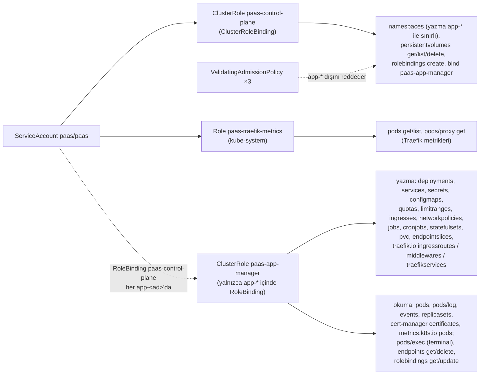

Yıldızlı (`*`) kaynak ya da fiil yoktur; `pods/exec` yalnızca tarayıcı terminali içindir ve
`PAAS_TERMINAL=false` ile birlikte `paas-app-manager`'dan kural kaldırılarak kümede de
kapatılabilir. Ele geçirilmiş bir kontrol düzlemi bugün uygulama namespace'lerinin içini (tüm
uygulamaların sırları ve veritabanları dahil) yönetebilir; `kube-system`'e, kendi namespace'ine,
cert-manager'a ve diğer namespace'lere yazamaz, küme rolü bağlayamaz, ayrıcalıklı pod
çalıştıramaz. Kalan sınırlar §9'dadır.

---

## 7. Güvenlik

### Kimlik doğrulama

- **GitHub OAuth girişi** (PKCE S256, 10 dk'lık imzalı `state`): GitHub erişim token'ı saklanmaz;
  kimlik `github_id`'dir. Giriş, izin listesi (kullanıcı / organizasyon), platform admin'leri,
  ekibe davet ya da açık kayıt (`PAAS_OPEN_SIGNUP`, asgari hesap yaşı) ile açılır.
- **Oturum:** durumsuz, HMAC-SHA256 imzalı `paas_session` çerezi (`HttpOnly`, `SameSite=Lax`,
  TLS'te `Secure`, 12 saat). Anahtar `PAAS_SESSION_KEY`; değişirse tüm oturumlar düşer. Rol ve
  askıya alma her istekte veritabanından okunur.
- **API token'ları:** `paas_` önekli, yalnızca SHA-256 özeti saklanır, süre ve iptal destekli.
  Eski `PAAS_API_TOKEN` admin token'ı sabit zamanlı karşılaştırılır; GitHub girişi varken
  kaldırılabilir.
- **GitHub App:** clone, status ve yorumlar kısa ömürlü kurulum token'larıyla yapılır. Bir
  kurulum ancak taze bir kullanıcı token'ıyla `GET /user/installations` onu listeliyorsa ve token
  akışı başlatan platform kullanıcısına aitse bir ekibe bağlanır; kurulum numarası tahmin
  edilebilir olduğu için kanıt sayılmaz. Bağlanmamış kurulumun repoları import'a sunulmaz.

### Yetkilendirme

Her uygulama bir ekibe aittir; çağıranın o ekipteki rolü `viewer < member < owner` sırasıyla
denetlenir. Okuma uçları `viewer`, değiştirenler `member`, ekip yönetimi `owner` ister. Başka
ekibin uygulaması `404` döner (ad sızmaz); sarmalanmamış bir uç da `lookupApp` içinde varsayılan
rolle korunur. **Platform admin'i** `PAAS_ADMIN_GITHUB_LOGINS`'teki kullanıcılar ve eski admin
token'ıdır: planları atar, ekip ve kullanıcıları askıya alır (`/api/admin/*`).

### Tarayıcı ve istek güvenliği

- **CSRF:** çerezle gelen her durum değiştiren istek oturuma bağlı bir token
  (`HMAC(key, "csrf"+nonce)`, saklanmaz) ve aynı host `Origin`/`Referer` ister. Bearer token'lı
  istekler bunu gerektirmez (başka site o başlığı ekleyemez).
- **CSP:** istek başına nonce; `script-src 'nonce-…' https://unpkg.com` (yalnızca SRI'lı htmx),
  `frame-ancestors 'none'`, `base-uri 'none'`, `form-action 'self'`; `nosniff`,
  `Referrer-Policy: same-origin`, `Cache-Control: no-store`.
- **Webhook imzaları:** GitHub teslimatları HMAC-SHA256, sabit zamanlı karşılaştırma. Giden
  bildirim webhook'ları `X-Paas-Signature` ile imzalanır ve `X-Paas-Delivery` idempotency
  anahtarı taşır; özel ya da yerel ağ adreslerine gönderim varsayılan olarak reddedilir (SSRF).
- **Hız sınırları:** giriş, import ve API yazmaları IP ve kullanıcı başına token bucket
  (`internal/ratelimit`); deploy koruması şifre denemeleri istemci başına sınırlıdır. Plan
  limitleri (proje, günlük deploy, build dakikası ve zaman aşımı, eşzamanlı build, alan adı,
  eklenti, kopya, cron, CPU / bellek kotası) ayrıca uygulanır.
- **Askıya alma:** askıya alınan ekip deploy edemez, kaynak gerektiren hiçbir şeyi değiştiremez,
  uygulamaları sıfıra ölçeklenir ve namespace kotası yeni pod'a kapanır; askıya alınan kullanıcı
  giriş yapamaz, token'ları çalışmaz.

### Sırlar

Uygulama değişkenleri **AES-256-GCM** ile şifrelenir (`internal/secret`): değer başına rastgele
12 baytlık nonce, biçim `v1:<anahtar>:<base64>`, ek veri (AAD) uygulama kimliği + değişken adı (+
ortam ve branch) olduğu için bir şifreli metin başka bir uygulamaya ya da değişkene kopyalanınca
çözülmez. Açılışta eski anahtarlar ve düz metin değerler güncel anahtarla yeniden şifrelenir;
anahtar yokken şifreli değer varsa süreç başlamaz. Eklenti şifreleri ve bildirim kanalı sırları
aynı anahtar halkasıyla mühürlenir. Değerler API'den ve arayüzden geri okunmaz.

### Deploy koruması (ForwardAuth)

Korumalı bir uygulamanın namespace'ine `Middleware paas-protect` (forwardAuth →
`http://paas.paas.svc.cluster.local/_auth/verify?app=<ad>`) eklenir ve kapsamdaki her Ingress onu
anotasyonla bağlar: `previews` kapsamında deploy adresleri ve preview alias'ları, `all`'da
production ve özel alan adları da. Kip `team` (ekibin girişli üyeleri) ya da `password`'dür.
Doğrulama oturumu kontrol düzlemindeki giriş sayfasında yapılır, tarayıcı uygulama host'una tek
kullanımlık (nonce'u veritabanında tüketilen) bir token'la döner ve host'a özel imzalı
`_paas_protect` çerezi alır. Ayar sürümü çereze gömülüdür: şifre ya da kip değişince herkes
çıkış yapar. Otomasyon için `X-Paas-Protection-Bypass` başlığı, paylaşım için süreli
`?paas_share=` bağlantıları vardır (ikisi de yalnızca SHA-256 olarak saklanır). Traefik CRD'leri
yoksa korumayı açmak rota güncellemesini başarısız kılar; rotalar açık bırakılmaz.

### Konteynerler ve bulut

Kontrol düzlemi imajı Alpine üzerinde UID 65532 ile çalışır (git ve `buildctl` gerektiği için
distroless değil), kök dosya sistemi salt okunurdur. Üretilen uygulama imajları **sayısal**
kullanıcıyla çalışır (node 1000, distroless 65532, nginx 101), çünkü kubelet `runAsNonRoot`'u
isimli `USER` için doğrulayamaz. buildkitd rootless'tır. EC2'de IMDSv2 zorunlu ve hop limiti 1'dir:
instance rolüne yalnızca host ağı erişir, uygulama pod'ları erişemez.

---

## 8. Dağıtım (AWS)

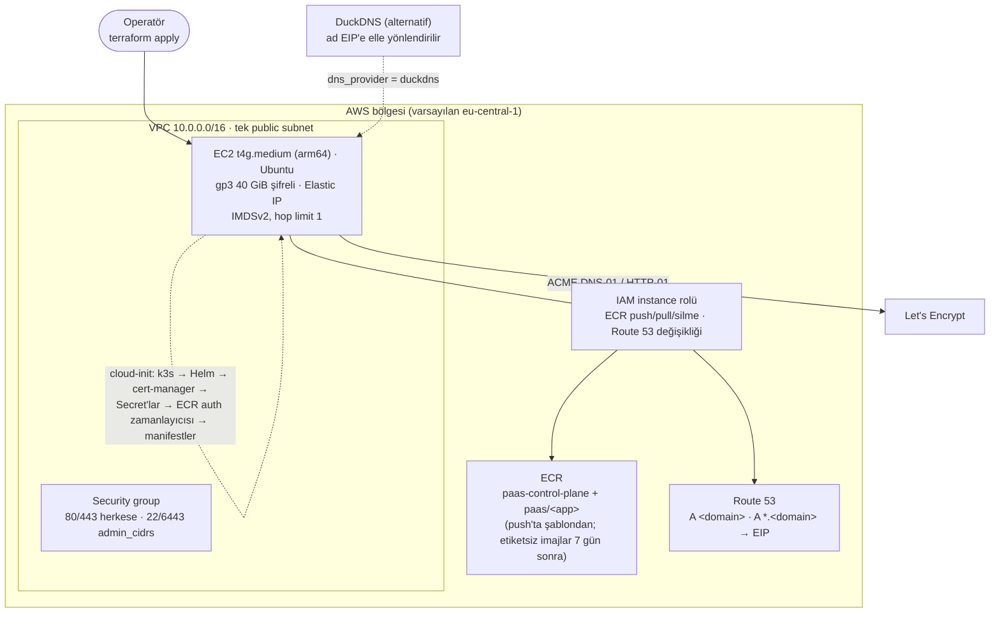

- **Terraform** (`infra/terraform`): VPC, subnet, security group, anahtar çifti, Elastic IP,
  t4g instance'ı, IAM rolü, ECR repo'su ve uygulama imajları için repository creation template,
  Route 53 kayıtları. Sırlar Terraform state'ine girmez: veritabanı şifresi, API token'ı, webhook
  sırrı ve env anahtarı düğümde `bootstrap.sh` tarafından üretilip Kubernetes Secret'ına yazılır.
- **Bootstrap** (cloud-init, tekrar çalıştırılabilir): rootless BuildKit için çekirdek ayarı,
  kubelet ECR credential provider (pod'lar imagePullSecret'sız çeker), sabit sürümlü k3s, Helm ile
  cert-manager (Route 53 için host ağında), Traefik CRD'lerinin beklenmesi, `buildctl` için 6
  saatte bir yenilenen ECR kimlik bilgisi (`paas-ecr-auth.timer`), `infra/k8s` manifestleri.
- **DNS ve TLS:** `dns_provider = "route53"`: apex ve wildcard A kayıtları, tek wildcard
  sertifika (DNS-01, instance rolüyle; kümede erişim anahtarı yok). `"duckdns"`: alt alan adları
  aynı IP'ye çözülür, wildcard sertifika alınamadığı için host başına HTTP-01 sertifikası.
- **Kontrol düzlemi apex'tedir:** her tek etiketli alt alan adı (`<app>.<domain>`) uygulamalara
  ait olduğundan `api.<domain>` gibi bir ad `api` adlı bir uygulamayla çakışırdı.

**Önerilen üretim kurulumu.** Arayüz ile kullanıcı uygulamalarını farklı kayıtlı alan adlarında
tutmak: örneğin arayüz `paas.example.com`, uygulamalar `*.example.app`. Aynı alan adında
uygulamalar arayüzle aynı siteden sayılır; `SameSite` çerezi bu durumda CSRF'e karşı koruma
sağlamaz (koruma CSRF token'ı ve Origin denetimine kalır) ve bir uygulama üst alan adına çerez
yazabilir. Uygulama alan adının DNS'i Cloudflare'de tutulup `*.example.app` için cert-manager'ın
Cloudflare DNS-01 çözücüsüyle wildcard sertifika alınabilir. Kodda arayüz adresi `PAAS_PUBLIC_URL`
ile ayrıdır (OAuth dönüşü, status bağlantıları, koruma girişi); apex `IngressRoute`'unun host'u ve
sertifikası buna göre değiştirilir. Terraform bu kurulumu bugün otomatik yapmaz.

---

## 9. Ölçeklenebilirlik ve bilinen sınırlar

**Çok kopyada güvenli olanlar.** İş kuyruğu (advisory lock + `SKIP LOCKED`), heartbeat'li çökme
kurtarma, yayın denetleyicisi ve eklenti döngüsü (kiralama + compare-and-set), bildirim outbox'ı
(`locked_until` kirası, `LISTEN` her kopyayı uyandırır, olaylar `(team, type, key)` ile tekil),
proje silme (`claimed_until`), deploy korumasının tek kullanımlık nonce'ları ve durumsuz
oturumlar.

**Tek kontrol düzlemi kopyası varsayan durumlar** (manifest `replicas: 1`):

- **Aktivatör:** uyuyan deploy'ların EndpointSlice'ı tek bir pod IP'sini (`PAAS_ACTIVATOR_IP =
  status.podIP`) gösterir; boşta kalma gözlemleri (`Scaler.seen`) bellektedir, yeniden başlatma
  sayaçları sıfırdan başlatır.
- **Hız sınırları ve şifre denemeleri** süreç belleğindedir; her kopya kendi payını uygular.
- **Koruma ayarı önbelleği** (5 sn) ve **terminal oturum sınırı** (kullanıcı başına 3) süreç
  başınadır.
- **Yönlendirme kilidi** süreç içidir; iki kopyanın senkronları kısa süre yarışabilir, dakikalık
  uzlaştırma düzeltir.

**Tek düğüm.** Postgres, build önbelleği ve eklenti diskleri düğümün `local-path` diskindedir;
eklenti yedekleri de aynı düğümde durur. Düğüm kaybı veri kaybıdır; düğüm dışı yedek yoktur.
`local-path` PVC genişletemez.

**İmaj saklama (Faz 30).** Registry, platformun tuttuğu deploy'ların imajlarını tutar; kör bir
sayı sınırı yoktur. Her deploy kendi etiketine itilir (`<app>:<sha>-<deploy id>`), böylece aynı
commit'in yeniden build'i başka bir deploy'un digest'le sabitlediği imajın etiketini taşımaz.
Temizleyici (`internal/cleanup`) emekliye ayrılan, başarısız ya da iptal edilen bir deploy'un küme
nesnelerini sildikten sonra imajını da siler: `store.ReleaseImage` aynı manifest'i (aynı repo +
aynı digest; imaj yeniden kullanan redeploy/promote ve aynı digest'i üreten build'ler bunu
paylaşır) gösteren bütün satırları `FOR UPDATE` ile kilitler; tutulan (`queued`, `building`,
`deploying`, `ready`: canlı, rollback hedefi, etkin preview) bir deploy hâlâ onu gösteriyorsa imaj
kalır, göstermiyorsa paylaşan bütün bitmiş satırlara `image_released_at` yazılır ve manifest
Docker Registry HTTP API v2 / OCI üzerinden digest'le silinir (`DELETE
/v2/<repo>/manifests/<digest>`, `internal/registry`). `CopyDeployment` kaynağı `FOR SHARE` ile
okur ve serbest bırakılmış bir imajı yeniden kullanmaz, commit'i yeniden build eder; iki işlemden
hangisi önce commit ederse diğeri onu görür. Registry silmesi başarısız olursa deploy temizlenmiş
sayılmaz ve bir sonraki taramada yeniden denenir. Proje silindiğinde repo'nun bütün etiketleri
silinir. ECR'de uygulama repo'larının yaşam döngüsü kuralı yalnızca **etiketsiz** imajları
`ecr_untagged_days` (7) gün sonra siler: ezilen build önbelleği ve imajı kaydedilmeden çöken bir
build'in itişi; bir index'in alt manifest'leri index durdukça silinmez. Kimlik bilgisi builder'ın
kullandığı Docker config'idir (`$DOCKER_CONFIG/config.json`, AWS'de `paas-ecr-auth` zamanlayıcısı
yeniler); rolün `ecr:BatchDeleteImage` izni vardır. Bilinen sınırlar: silme kapalı bir registry
(`registry:2` varsayılanı, k3d registry'si) `UNSUPPORTED` döner; imaj kalır, uyarı loglanır.
`registry:2` disk alanını ancak `registry garbage-collect` ile geri verir. Credential helper
(`credsStore`) kullanan Docker config'leri okunmaz (yalnızca satır içi `auths`).
`PAAS_IMAGE_GC=false` silmeyi kapatır.

**Diğer sınırlar.**

- Web süreci deploy başına tek kopyadır (elle ölçeklenmez); yatay ölçek worker süreçleriyle
  sınırlıdır.
- Her hazır deploy bir pod tutar; maliyet kota, saklama politikası ve sıfıra ölçeklemeyle
  sınırlanır.
- Durumsuz oturumlar tek tek iptal edilemez (rol ve askıya alma her istekte okunduğu için
  yetki kaybı anında etkilidir; oturumun kendisi süresi dolana kadar geçerlidir).
- Env anahtarı Kubernetes Secret'ında durur, KMS ile sarılmaz.
- Canary kararları dakikalık metriklere dayanır; bu yüzden adım en az 2 dakikadır.
- İzin listeleri GitHub kullanıcı adıyla eşleşir; bırakılan bir ad başkasınca alınabilir.
- **RBAC (Faz 29).** Admission politikaları ServiceAccount adını (`paas:paas`) sabit taşır;
  kontrol düzlemi başka bir namespace'e ya da adla kurulursa politikalar da güncellenmelidir.
  `ValidatingAdmissionPolicy` Kubernetes 1.30 ve üstünü ister (k3s v1.35 sağlar). Küme genelinde
  kalan okumalar namespace ve PersistentVolume meta verisidir; `kube-system`'de Traefik
  pod'larının listesi ve pod proxy'si okunur (proxy pod adıyla sınırlanamaz, pod adları değişir).
  Uygulama namespace'leri arasında ayrım yoktur: tek bir kimlik hepsini yönetir.

---

## 10. Tasarım kararları

| Karar | Neden | Bedeli |
|---|---|---|
| Kuyruk olarak PostgreSQL (`SKIP LOCKED`), Redis / Kafka yok | İş, durum ve alias aynı transaction'da; "kuyruğa yazıldı ama durum yazılmadı" olamaz. Tek düğümde ayrı bir broker işletme yükü. Darboğaz kuyruk değil build | Çok yüksek iş hacminde yoklama maliyeti; bu ölçekte ölçülebilir değil |
| Veritabanı tek doğruluk kaynağı, küme ona uzlaştırılır | Kararlar (alias, rollback) bir yerde verilir; küme hatası kararı kaybettirmez, döngü uygular | Küme anlık olarak geride kalabilir (en fazla bir döngü) |
| Değişmez deploy'lar + alias'lar | Rollback anlıktır (API p95 23 ms); her commit kalıcı bir adreste test edilebilir; yarışlar "alias yalnızca ileri gider" kuralıyla çözülür | Her deploy bir pod; kota, saklama ve sıfıra ölçeklemeyle sınırlanır |
| Uygulama başına namespace | Kota, LimitRange ve NetworkPolicy doğal sınırla uygulanır; silme tek namespace silmesidir; kontrol düzleminin yetkisi namespace başına RoleBinding'le yalnızca uygulama namespace'lerine bağlanır (Faz 29) | Namespace başına RoleBinding ve admission politikaları; çok sayıda namespace |
| Sunucu tarafı `html/template` + htmx | Build adımı yok, tek ikili, JS olmadan çalışan formlar, sıkı CSP | Zengin istemci etkileşimleri sınırlı |
| Standart Ingress, CRD yalnızca gerektiğinde | Tipli client-go, test edilebilir, ingress denetleyicisinden bağımsız | Canary ve ForwardAuth Traefik'e bağlıdır |
| Tek etiketli host'lar + wildcard sertifika | Tek sertifika tüm deploy ve alias'ları kapsar, Let's Encrypt sınırlarına takılmaz | Kontrol düzlemi apex'te; uygulama adları alt alan adlarıyla çakışmamalı |
| SHA ile fetch, digest'le sabitlenen imaj | Kuyrukta beklerken gelen push build'i değiştiremez; etiket ezilse de çalışan imaj aynı | — |
| Registry saklaması deploy saklamasını izler (Faz 30), sayı sınırı yok | Rollback hedefi ya da canlı deploy'un imajı preview push'larıyla silinemez; emekli deploy'ların imajları silinip yer açılır; karar digest başına verilir | Kontrol düzlemi registry'de silme yetkisi taşır; silme kapalı registry'lerde imajlar birikir |
| Rootless BuildKit, kontrol düzleminden ayrı pod | Build ayrıcalıksız çalışır; kontrol düzlemi salt okunur kalır | Ayrı bir bileşen ve önbellek diski |
| Tek Go ikilisi, döngüler aynı süreçte | Dağıtımı ve gözlemlemesi tek parça; durum veritabanında olduğu için süreç yeniden başlatılabilir | Bazı döngüler tek kopya varsayar (§9) |
| Uzun eklenti işleri deterministik adlı Job'lar | Tekrar çalışan adım ikinci iş başlatmaz; çökme sonrası kaldığı yerden sürer | Sonuçlar pod sonlandırma mesajından okunur |
| Bildirimler için outbox | Olay deploy ile aynı veritabanında; en az bir kez teslim, idempotency anahtarıyla | Teslimat gecikmesi dağıtıcı aralığı kadar |
